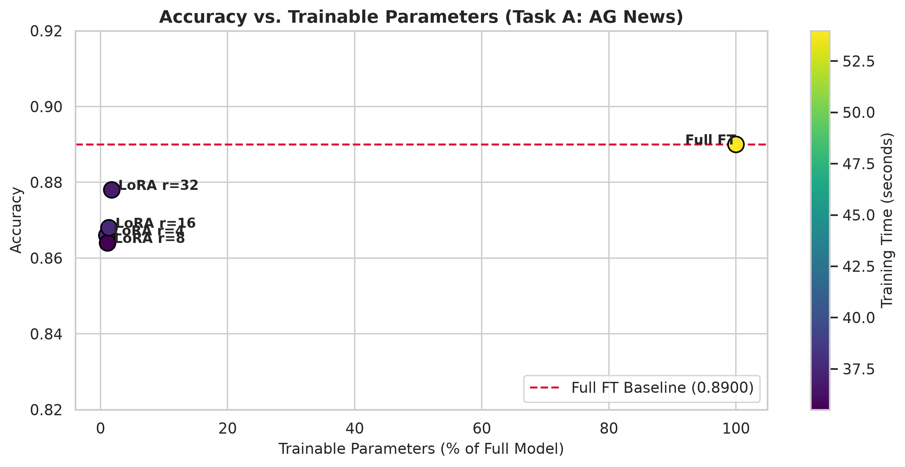
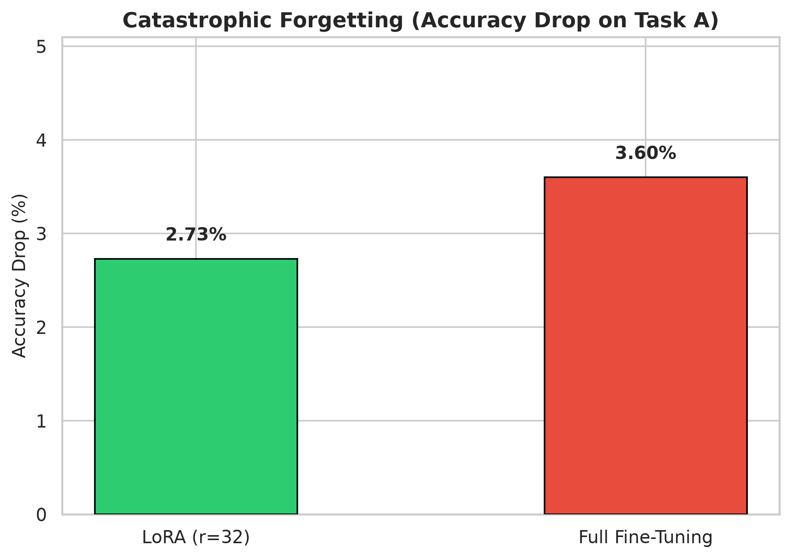

# Parameter-Efficient Fine-Tuning (LoRA) & Continual Learning

[](https://colab.research.google.com/github/laapalhares/lora-continual-learning/blob/main/phase1_experiments.ipynb)
[](https://www.python.org/downloads/)
[](https://pytorch.org/)
[](https://huggingface.co/docs/transformers)
[](https://huggingface.co/docs/peft)

**Author:** Larissa Palhares  
**Institution:** Universidade Estadual de Campinas (UNICAMP)  

---

## Overview

This repository benchmarks **Full Fine-Tuning** against **Parameter-Efficient Fine-Tuning (LoRA)** using `distilbert-base-uncased`, focusing on two aspects:
1. **Performance vs. Parameter Efficiency:** Evaluating how LoRA rank ($r \in [4, 8, 16, 32]$) affects accuracy and training time on multi-class topic classification (**AG News**, 4 classes) while keeping the scaling factor constant ($\alpha / r = 2.0$).
2. **Catastrophic Forgetting:** Measuring retention drop on Task A after sequentially fine-tuning on a secondary domain (**IMDB** sentiment analysis, 2 classes).

---

## Experimental Results

All experiments were run locally using `distilbert-base-uncased` (66.95M parameters):

### 1. Parameter Efficiency (Task A: AG News)

| Method | LoRA Rank ($r$) | Scaling ($\alpha/r$) | Trainable Params | % of Full Model | Accuracy | Macro F1 | Training Time |
| :--- | :---: | :---: | :---: | :---: | :---: | :---: | :---: |
| **Full Fine-Tuning** | — | — | 66,956,548 | 100.0% | **89.00%** | **0.8906** | 53.97s |
| **LoRA** | 4 | 2.0 | 667,396 | **1.00%** | 86.60% | 0.8672 | **38.06s** |
| **LoRA** | 8 | 2.0 | 741,124 | 1.11% | 86.40% | 0.8654 | 35.51s |
| **LoRA** | 16 | 2.0 | 888,580 | 1.33% | 86.80% | 0.8691 | 37.67s |
| **LoRA** | 32 | 2.0 | 1,183,492 | 1.77% | **87.80%** | **0.8790** | 36.88s |

LoRA reaches **97.3% of Full Fine-Tuning accuracy** with only **1.00% of parameters** ($r=4$), and up to **98.6%** at $r=32$, training ~30% faster per epoch.



---

### 2. Catastrophic Forgetting (Task A $\rightarrow$ Task B $\rightarrow$ Eval A)

Models trained on Task A (AG News, 4 classes) were adapted to Task B (IMDB, 2 classes) by replacing the classification head. Afterwards, the original Task A head was restored to measure accuracy drop:

$$\text{Loss (\%)} = \frac{\text{Acc}_{\text{initial}} - \text{Acc}_{\text{final}}}{\text{Acc}_{\text{initial}}} \times 100$$

| Method | Initial Acc (Task A) | Adaptation Acc (Task B) | Final Acc (Task A) | Final Macro F1 (Task A) | Absolute Drop | Relative Loss (%) |
| :--- | :---: | :---: | :---: | :---: | :---: | :---: |
| **LoRA ($r=32$)** | 87.80% | 82.40% | 85.40% | 0.8554 | **-2.40%** | **2.73%** |
| **Full Fine-Tuning** | 89.00% | 84.20% | 85.80% | 0.8580 | **-3.20%** | **3.60%** |

LoRA retains Task A knowledge better than Full Fine-Tuning because pre-trained backbone weights ($W_0$) remain frozen during adaptation, mitigating representation drift.



---

## Repository Structure

```
fine-tuning/
├── README.md                          # Project overview and experimental results
├── requirements.txt                   # Project dependencies
├── .gitignore                         # Git ignore file
├── run_experiments.py                 # CLI script to run all experiments
├── phase1_experiments.ipynb           # Interactive notebook
├── src/                               # Helper modules
│   ├── __init__.py
│   ├── config.py                      # ExperimentConfig dataclass
│   ├── utils.py                       # Seed setting and parameter counter
│   ├── data.py                        # Dataset loading and tokenization
│   ├── metrics.py                     # Accuracy, F1, Precision, Recall
│   ├── models.py                      # DistilBERT and LoRA model factories
│   ├── continual.py                   # Sequential head swapping and evaluation
│   └── training.py                    # Training loops for Full FT and LoRA
└── outputs/                           # Saved figures and CSV summaries
    ├── results_tradeoff.csv
    ├── results_catastrophic_forgetting.csv
    ├── tradeoff_frontier.png
    └── catastrophic_forgetting.png
```

---

## Notes on Methodology

1. **Balanced Sampling:** IMDB was shuffled with a fixed seed before taking subsets to ensure a balanced 50/50 split of positive and negative reviews.
2. **LoRA Scaling:** The scaling ratio $\alpha / r = 2.0$ was kept constant across all ranks ($r \in [4, 8, 16, 32]$) to isolate the effect of rank from the learning rate multiplier.
3. **Head Swapping:** The Task A linear classifier was deep-copied and restored after training on Task B to isolate representation drift in the backbone.
4. **Metrics:** Macro F1, Weighted F1, Precision, and Recall were recorded alongside Accuracy.

---

## How to Run

### Interactive Notebook
Open `phase1_experiments.ipynb` directly in VS Code or in Google Colab (using the badge at the top).

### Command Line
1. Clone the repository and install requirements:
   ```bash
   git clone https://github.com/laapalhares/lora-continual-learning.git
   cd lora-continual-learning
   python3 -m venv .venv
   source .venv/bin/activate
   pip install -r requirements.txt
   ```

2. Run the experiments:
   ```bash
   python run_experiments.py --epochs 3 --batch_size 16
   ```

---

## References

- Hu, E. J., et al. (2021). *LoRA: Low-Rank Adaptation of Large Language Models*. arXiv:2106.09685.
- Sanh, V., et al. (2019). *DistilBERT, a distilled version of BERT*. arXiv:1910.01108.
- McCloskey, M., & Cohen, N. J. (1989). *Catastrophic interference in connectionist networks*.
